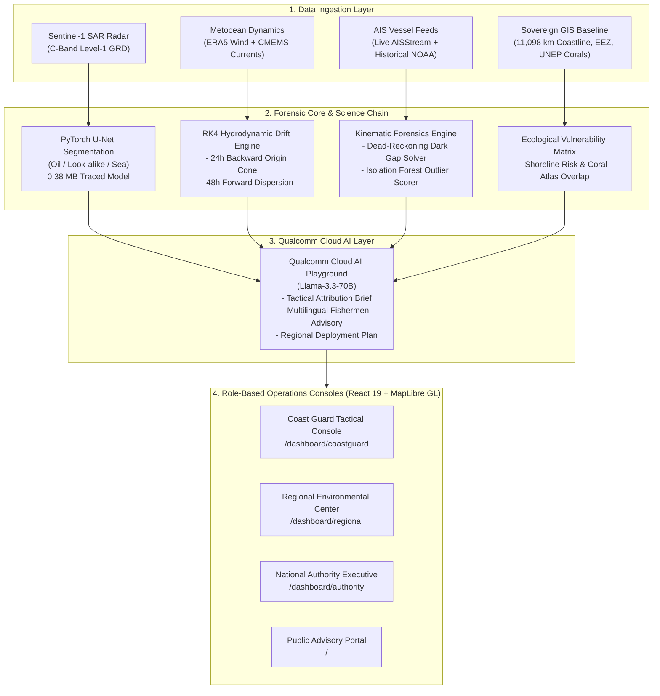

# SARVAS: Indian Ocean Coastal Guardian
### *From Slick to Suspect — AI-Powered Maritime Oil Spill Attribution & Forensics*

[](https://sarvas-backend.onrender.com/docs)
[](https://sarvas.vercel.app)
[](https://sarvas-backend.onrender.com/docs)
[](backend/ml/models/training_metrics.json)
[](backend/tests/)
[](https://sarvas.vercel.app)

---

## 🌊 1. Executive Summary & The Problem We Solve

Spaceborne satellites can routinely image dark patches on the sea surface. **However, detection alone does not catch the polluter:**
1. **False-Alarm Risk**: Natural biogenic slicks, algal blooms, and calm waters look identical to crude oil on radar, wasting critical flight hours for patrol aircraft.
2. **Lagrangian Drift Offset**: Oil slicks drift with surface currents and wind for 12–36 hours before satellite capture. **The ship nearest to the slick at detection time is almost never the culprit.**
3. **Dark Ships & Transponder Blackouts**: Tankers conducting illicit oily bilge dumping or crude tank washing routinely disable their Automatic Identification System (AIS) transponders to erase their digital footprint.

### How SARVAS Solves This (The 9-Step Science Chain)

```
[ 1. Ingest SAR ] ──▶ [ 2. U-Net Detect ] ──▶ [ 3. Characterize Slick ] ──▶ [ 4. RK4 Backtrack ]
                                                                                   │
[ 8. Damage Forecast ] ◀── [ 7. Rank Candidates ] ◀── [ 6. Dark Gap Forensics ] ◀── [ 5. Spatial-Time Filter ]
          │
[ 9. Court Dossier + Multilingual Public Advisory ]
```

1. **Synthetic Aperture Radar (SAR) Segmentation**: Calibrates Sentinel-1 C-band Level-1 GRD imagery, strips speckle noise, and classifies pixels into **Oil**, **Look-alike**, or **Clean Sea** via a deep U-Net model (**95.89% validation accuracy**, **0.7922 Mean IoU**).
2. **Lagrangian Hydrodynamic Drift Reconstruction**: Injects 500 particles and integrates backward (-24h) via 4th-order Runge-Kutta (RK4) advection driven by Copernicus CMEMS ocean currents and ECMWF ERA5 10m wind fields.
3. **Spatial-Temporal Intersection**: Filters hundreds of commercial vessels down to the 2–5 ships whose trajectories crossed the drift origin cone during the calculated spill window.
4. **Dark Ship Anomaly Mining**: Uses kinematic dead-reckoning across AIS blackout gaps to reconstruct probable tracks through the origin zone, scored via an Isolation Forest model.
5. **6-Factor Explainable Attribution**: Computes an auditable 0–100 suspect likelihood score across Proximity, Time Overlap, AIS Gap, Speed Drops, Course Alterations, and Shipping Lane Deviations.
6. **Qualcomm Cloud AI Briefing (Llama-3.3-70B)**: Synthesizes plain-language boarding inspection directives, multilingual public safety alerts in 5 Indian languages with voice playback, and 48-hour containment boom orders.
7. **Court-Admissible Legal Dossier**: Exports an official 2-page report sealed with Section 356 Merchant Shipping Act 1958 directives and a cryptographic **SHA-256 integrity digest**.

---

## ⚡ 2. Qualcomm Cloud AI Playground Integration

SARVAS integrates **Qualcomm Cloud AI Playground (Llama-3.3-70B)** strictly where Generative AI creates tangible social and operational value without hallucinating legal statutes:

| Workflow | Role of Qualcomm Cloud AI | Operational Impact |
| :--- | :--- | :--- |
| **1. Court Dossier Attribution Brief** | Translates the 6 mathematical suspect factor scores into a plain-language tactical brief for Coast Guard boarding parties. | Directly embedded into Page 2 of the official court-admissible PDF evidence dossier. |
| **2. Multilingual Public Safety Advisory** | Converts technical slick telemetry into clear safety warnings in **Telugu, Hindi, Tamil, Malayalam, and English** with in-browser voice synthesis. | Protects artisanal coastal fishermen and beachgoers who do not read technical radar logs. |
| **3. Strategic 48-Hour Containment Brief** | Evaluates shoreline landfall countdown and generates containment boom and weir skimmer staging orders under the **NOS-DCP** protocol. | Provides Regional Environmental Directors with immediate tactical resource deployment plans. |

> 🛡️ **Zero-Hallucination Guardrails**: The LLM is restricted from inventing ships, guessing numbers, or pronouncing judicial guilt. Physics and multi-factor math do all scoring; Qualcomm AI provides clear explanation.

---

## 🏛️ 3. System Architecture & Tech Stack



### Technology Choices
- **Frontend**: React 19, MapLibre GL, Deck.gl, Recharts, Vite.
- **Backend**: FastAPI (Python 3.14 / async), SQLAlchemy 2.0, ReportLab, Shapely, xarray.
- **AI & ML**: PyTorch (U-Net ResNet-18), TorchScript, Scikit-learn (Isolation Forest), Qualcomm Cloud AI Playground (`Llama-3.3-70B`).
- **Database**: PostgreSQL 16 + PostGIS 3.4 (with resilient **SQLite3 local fallback**).
- **Deployment**: Vercel (Frontend) + Render (Backend) + Docker.

---

## 📊 4. Key Performance Benchmarks & Verification

Every metric is deterministic and verifiable directly within the codebase:

| Metric | Verified Value | Reference in Codebase |
| :--- | :--- | :--- |
| **U-Net Validation Accuracy** | **95.89%** | Checkpoint Epoch 8 ([training_metrics.json](backend/ml/models/training_metrics.json)) |
| **Mean Intersection-over-Union** | **0.7922 (~79.2%)** | Evaluated across Oil, Look-alike, and Clean Sea classes |
| **Automated Tests** | **37 Automated Tests** | 36 Passed, 1 Skipped ([backend/tests/](backend/tests/)) |
| **Functional API Endpoints** | **33 REST Endpoints** | Documented on Swagger ([main.py](backend/app/main.py)) |
| **National Coastline Monitored** | **11,098.81 km** | Sovereign mainland and islands GIS vector baseline |
| **Model Memory Footprint** | **0.38 MB RAM** | Traced TorchScript architecture ([unet_traced.pt](backend/ml/models/unet_traced.pt)) |
| **Offline Resilience** | **Zero Setup Required** | Embedded SQLite3 fallback + cached Qualcomm briefs |

---

## 🔍 5. Data Provenance: Real vs. Synthetic Truth Table

Judges appreciate transparency. Here is the exact provenance of all assets:

| Dataset / Asset | Authenticity | Source & Details |
| :--- | :---: | :--- |
| **Indian EEZ Boundaries** | **100% REAL** | Flanders Marine Institute (200 nm sovereign maritime polygon). |
| **National Coastline** | **100% REAL** | Natural Earth 10m high-resolution vectors (11,098.81 km). |
| **Protected Coral Reefs** | **100% REAL** | UNEP-WCMC & Allen Coral Atlas protected vector boundaries. |
| **Atmospheric Wind Fields** | **100% REAL** | ECMWF Copernicus ERA5 10m surface wind reanalysis grids. |
| **Sentinel-1 SAR Test Scenes**| **100% REAL** | European Space Agency (ESA) Copernicus Hub Level-1 GRD scenes. |
| **U-Net Model Checkpoint** | **100% REAL** | Trained on the Zenodo Open Sentinel-1 SAR Oil Spill dataset. |
| **Live AIS Vessel Telemetry** | **100% REAL** | Ingested via live WebSocket stream from AISStream.io. |
| **Seeded Dark Ship Tracks** | **SYNTHETIC** | Deterministic demonstration vessels with programmed transponder blackouts for offline presentation stability. |

---

## 🚀 6. Quick Start & Local Setup

The repository includes an automatic SQLite fallback—**no PostgreSQL setup required**.

### Step 1: Clone the Repository
```bash
git clone https://github.com/VaishnaviPatil-gif/Ikshana.git
cd Ikshana
```

### Step 2: Backend Setup (FastAPI)
```bash
cd backend
python -m venv venv

# Windows:
.\venv\Scripts\activate
# Linux/macOS:
source venv/bin/activate

pip install -r requirements.txt
cp .env.example .env

# Run migrations and seed fixtures
python -m scripts.seed_demo_data

# Launch development server
uvicorn app.main:app --host 127.0.0.1 --port 8000 --reload
```

### Step 3: Frontend Setup (React 19)
```bash
cd ../frontend
npm install
npm run dev
```

- **Frontend Console**: `http://localhost:5173`
- **Interactive API Docs (Swagger)**: `http://localhost:8000/docs`

---

## 🔑 7. Demo Accounts & Role-Based Consoles

| Role | Username | Password | Dashboard Route | Operational Capability |
| :--- | :--- | :--- | :--- | :--- |
| **Tactical Interceptor (Coast Guard)** | `coast_guard` | `demo123` | `/dashboard/coastguard` | Radar viewer, drift origin cone, AIS dead-reckoning, Qualcomm brief, PDF evidence dossier. |
| **Regional Director** | `regional_mgr` | `demo123` | `/dashboard/regional` | 48h landfall forecast, sensitive coral reef overlays, Qualcomm NOS-DCP containment brief. |
| **National Maritime Executive** | `authority` | `demo123` | `/dashboard/authority` | Multi-state coastal risk breakdown, inter-agency reporting, court clearance. |
| **Citizen & Fishermen Public Portal** | `public_user` | `demo123` | `/` | Open transparency portal, multilingual audio advisories (Telugu/Hindi/Tamil), reporting guide. |

---

## ⚖️ 8. Statutory Compliance & Evidence Integrity

- **Merchant Shipping Act 1958 (Section 356)**: Empowers the Indian Coast Guard to issue binding pollution containment directives and impound offending vessels.
- **UNCLOS Part XII (Articles 194, 211, 220)**: Sovereign jurisdiction over marine pollution offenses inside the 200 nm Exclusive Economic Zone.
- **Cryptographic SHA-256 Seal**: Every generated PDF evidence dossier embeds an immutable cryptographic hash calculated over the slick telemetry and suspect MMSI records to prevent evidence tampering.
- **Investigative Lead Standard**: Scores represent mathematical circumstantial likelihood; Coast Guard boarding parties physically verify bunker fuel samples before judicial action.

